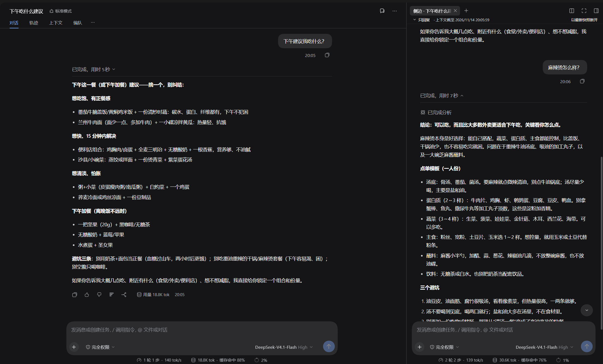
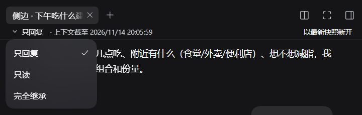
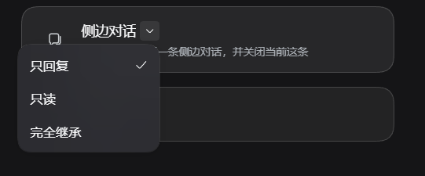
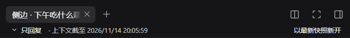

<div align="center">

# dsh-side-chat

**A throwaway side conversation in the right sidebar: it inherits the current session's context, and never writes back into it.**

Three modes — *reply only* / *read-only* / *fully inherited* — enforced in code, not by asking the model politely.

[](https://www.npmjs.com/package/@aixineiar/dsh-side-chat)
[](LICENSE)
[](#compatibility)
[](#compatibility)
[](#development)

</div>



> Left: the main session. Right: a side chat seeded from its context — the tab is titled「侧边 · …」and its status bar names the mode and the snapshot time. Answers stay on that side; nothing in the main session's history is rewritten.

---

## Why

A main session is one continuous, persisted context that every later request carries. Some questions do not deserve to occupy it. A side chat is a **shadow branch** of the main session:

- **Inherited** — at open time the main session's committed log is copied (including the committed steps of a turn still running), so it knows what you were just talking about.
- **Isolated** — its own agent, its own model choice, its own history. Answers stay in the sidebar and never enter the main session.
- **Disposable** — close the tab and the agent is disposed, its log file and directory deleted. No archive, no "resume later".

## Three modes



*The mode menu on the tab's status bar: reply only / read-only / fully inherited — picking one switches the open thread in place. The choice is remembered; the default is read-only.*

| | **Reply only** `reply` | **Read-only** `read` (default) | **Fully inherited** `full` |
|---|---|---|---|
| Tools | none | read-only allowlist (12 by default) | same as the main session |
| Tool schemas in the request | omitted | read-only tools only | all |
| Host `tool:*` usage paragraphs | none (the host renders them per scope) | only those for callable tools | all |
| Writes / commands / subagents | impossible | impossible | allowed (host permissions and sandbox apply) |
| Tool quota | n/a | 1 read call per step | none |
| On a modification request | prints a "modification suggestion to run in the main session" block | same, may use that step's one read to confirm the target | prints a plan, asks once "run here or in the main session?" |

**Reply only** — no tool channel at all: the host calls `tools.restrict({ deny: … })`, so the request carries no tool schemas, and text that imitates a call is just text (nothing parses it, nothing answers it). A backstop `tools.guard` refuses anything that slips through. Good for "one sentence, please", "what does this error mean", "which option is safer".

**Read-only** (default) — inherits the context plus `read`, `read_image`, `glob`, `grep`, `lsp`, the five `session_*` tools, `web_search`, `web_fetch`. **One read call per model step**, success or failure counts. Tool paragraphs follow the session's visible tool set — the host renders every `tool:*` section against it, so a masked tool's paragraph is already empty and this plugin never rewrites `system-prompt/assemble`.

**Fully inherited** — same capabilities as the main session, different stance: the inherited history is reference, not a task; answers stay in the sidebar; a modification request gets a plan first, then exactly one question — *run it here, or in the main session?* Choosing "main session" prints the same suggestion block and stops all writes.



*Entry point: the side-chat card in the tool panel. Its `⌄` menu opens a **new** side chat — the subtitle turns into that hint while the menu is open.*

### Same sentence, three modes

> "Change `parseDate` in `src/utils.ts` to accept ISO strings."

- **reply** — answers "this side chat does not perform writes, nothing was changed", plus the suggestion block. It never opened the file (unless the inherited history contains it).
- **read** — same, but it may spend its one read of the step to look at `src/utils.ts` first. No writes.
- **full** — prints a plan and asks once; "run here" edits your workspace, "main session" prints the suggestion block and stops.

## Install

A **DSH plugin** (host + client halves), loaded by DSH through a profile bundle.

Requirements: DSH **0.2.2-rc.3**, Node ≥ 20, pnpm, and the main session **running** (open on the left) — the plugin seeds from its latest committed event.

**A. By name (recommended)**

Package name: **`@aixineiar/dsh-side-chat`**. In the DSH sidebar's *Plugins* page, choose *Add plugin* and type that name — pnpm resolves it from the npm registry, and because the package declares `dsh.bundle`, it is appended to the profile's `dsh.profile.bundles` automatically.

```bash
# equivalent command line, inside the profile directory
cd <DSH_HOME>/profiles/<profile>          # Windows default: %USERPROFILE%\.dsh\profiles\desktop
pnpm add @aixineiar/dsh-side-chat
```

A command-line install still needs the bundle entry added by hand (after `@deepseek-ai/dsh-base` and `@deepseek-ai/dsh-web-app`):

```json
{
  "dependencies": { "@aixineiar/dsh-side-chat": "^1.0.0" },
  "dsh": { "profile": { "bundles": [
    "@deepseek-ai/dsh-base",
    "@deepseek-ai/dsh-web-app",
    "@aixineiar/dsh-side-chat"
  ] } }
}
```

> Before installing, the plugin manager reads the manifest once: an unmet `engines.dsh` (this package declares `^0.2.2-rc.1`) refuses the install instead of installing and rolling back.

**B. From GitHub** — works today, without waiting for a publish:

```bash
cd <DSH_HOME>/profiles/<profile>
pnpm add "github:Aixineiar/dsh-side-chat"
```

**C. Local directory** (development / editing the source):

```bash
git clone https://github.com/Aixineiar/dsh-side-chat.git dsh-side-chat
cd <DSH_HOME>/profiles/<profile>
pnpm add "link:/absolute/path/to/dsh-side-chat"
```

**D. Profile patch only** — mount without adding a dependency (the package must already resolve):

```yaml
- insert:
    - id: side-chat
      name: '@aixineiar/dsh-side-chat'
```

The bundle's own [`cordis.patch.yml`](cordis.patch.yml) already carries that row, so a manager install needs no YAML work.

**Restart DSH**, open a session that has messages, and look for the「侧边对话」card in the tool panel or the sidebar button in the conversation header. Uninstall with `pnpm remove` plus deleting the `bundles` entry.

## Usage

Two entry points (tool panel card, conversation header button). Both the header button and the default mode of a new side chat are page settings on the plugin's own page (`localStorage`, no restart; the header entry registers and unregisters from the same change). Inside the tab the status bar shows the mode chip and「上下文截至 <time>」plus a「以最新快照新开」action (opens a fresh snapshot and closes the current side chat); the composer has its own model picker that does not touch the global default; the stop button cancels the running turn.

The mode menu beside the card title picks the mode for a **new** side chat: choosing one opens a new tab and closes the current one, so the old conversation (and everything it produced) is discarded. The card subtitle says so while the menu is open.

The mode chip on the tab's status bar switches **in place**: same agent, same log, same conversation, nothing opened or closed. It takes effect on the next request (the tool list is re-declared and the host's own tool-change notice counts the additions and removals), and every switch permanently adds two user-role messages to that thread — a one-line「从 X 切到 Y」notice followed by the new mode's explanation. Switching to the mode the thread already has queues nothing. A tab restored from an older build without a recorded mode shows no chip and keeps the plain line instead of guessing.



*The tab's status bar: the mode chip on the left (opens the in-place switch), the「以最新快照新开」action on the right.*

**Closing the tab deletes the side chat** — agent disposed, log file and directory removed. A boot sweep cleans up leftovers from crashes. If the dispose or the deletion fails, the thread is deliberately kept and the card offers「重试关闭」for exactly those threads.

While it lives, a side chat is an ordinary catalog entry titled「侧边 · <main title>」, so it appears in any list rendered from the session catalog; closing the tab removes it again.

## Development

No build step (ESM, no TypeScript, no bundler). `npm test` runs two suites: `dev/boot-sim.mjs` (220 assertions over both halves) and `node --test dev/` (16 interaction-level Client assertions, driven through the registered surfaces rather than private helpers). See [CONTRIBUTING.md](CONTRIBUTING.md).

## Compatibility

Validated on DSH **0.2.2-rc.3** only. The host contracts this plugin actually uses, all checked on that build:

`tools.view/restrict/guard/definitions` · `systemPrompt.section` · `agents.create/get/list` · `agentPresets.presetForSession/resolve/mount` · `agentDefaultModel.currentSelection` · `sessionTitle.rename` · `sessionQuery.observeSession` · `sessionPersistence.stat/list` (plus the jsonl backend's `locate`) · `workspaceRegistry.archivedSessionIds/unarchiveSession` · `webServer.register` + `connection.requestRejection` · client side: `sessions.retain/refresh/using/list`, `resources.register`, `sidebarRightTabs.register`, `sidebarRight.openResource/registerCloseHandler`, `slots.register/inject`, `locale.register/bind`.

`engines.dsh` only decides whether the package can be installed; this table is what to re-check when the host moves. An earlier build carried fallbacks for `sessionController.composeAgent`, `sessionController.presetForSession` and `sessionPersistence.locate`: the first two belong to the controller's internal agent controller rather than the `sessionController` service, and the third is a jsonl-backend extra rather than a `SessionPersistence` contract member — none of them could ever run.

Known limits: the read quota is per *step*, not per answer; the side chat does not follow the main session after opening; closing is irreversible; a mode switch leaves two permanent user-role messages in the thread and the in-flight step keeps the system section it was assembled with (the tool mask and the guard change immediately); choosing a mode on the guide card still opens a new thread; the control route accepts text parts and already-admitted attachment references only; a thread that could not be closed stays visible on the card with a retry; threads parked in the archive by older builds are cleaned up at boot; the client half is a single file because the DSH client loader cannot synchronously require sibling `client*.js` files.

## Security

Tool gating is implemented in the host tool registry (`restrict` + `guard`), so the model cannot reach a masked tool even if it ignores every instruction. Control actions go through `POST /dsh-side-chat/api`, are authenticated by the host connection layer, and a close verifies that the session is really a thread this plugin created before disposing or deleting anything.

Every refusal carries a stable `code` and its HTTP status (400 bad request, 403 not this plugin's thread, 409 thread gone, 413 body too large, 500 I/O); the page renders a local sentence, and the host's raw message only reaches the console. The `prompt` action accepts text blocks and attachment references the host already promoted — anything else is dropped and counted, and an entirely invalid prompt answers 400 without committing a session event.

Report vulnerabilities privately — see [SECURITY.md](SECURITY.md).

## License

[MIT](LICENSE).
