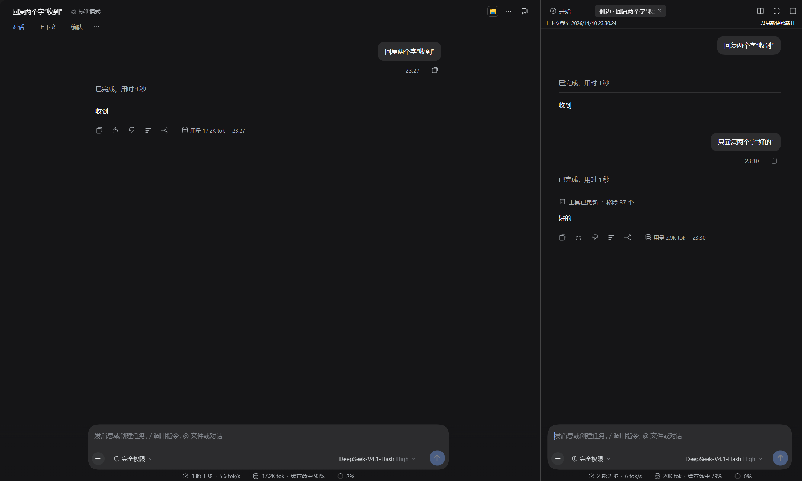
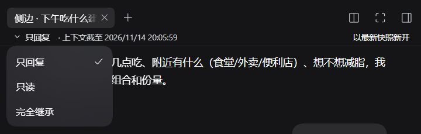
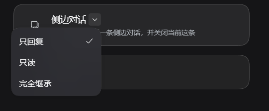

<div align="center">

# 侧边对话 · dsh-side-chat

**在右侧栏开一条临时对话：继承当前会话的上下文，但绝不写回主会话。**

三种模式 —— 只回复 / 只读 / 完全继承，约束落在**实现层**，不靠提示词自律。

[](LICENSE)
[](#兼容性与已知限制)
[](#兼容性与已知限制)
[](#开发与测试)

</div>



> 左：主会话。右：从它继承上下文的侧边对话。中间那行「工具已更新 · 移除 37 个」是**只回复**模式打开时把全部工具摘掉的宿主记录 —— 不是提示词说「你没有工具」，而是这条会话的工具集真的被裁掉了。

---

## 目录

- [它解决什么问题](#它解决什么问题)
- [三种模式](#三种模式)
  - [同一句话，三种模式分别发生什么](#同一句话三种模式分别发生什么)
  - [怎么选模式](#怎么选模式)
- [安装](#安装)
- [使用](#使用)
- [与其他做法对比](#与其他做法对比)
- [实现](#实现)
- [配置](#配置)
- [开发与测试](#开发与测试)
- [兼容性与已知限制](#兼容性与已知限制)
- [安全](#安全)
- [贡献 · 许可](#贡献--许可)

---

## 它解决什么问题

主会话是一条**连续、会被持久化、会影响后续每一步**的上下文。有些问题不该占用它：

| 场景 | 直接在主会话里问的代价 |
|------|------------------------|
| 「这个函数到底做了什么？」 | 一大段解释留在历史里，之后每次请求都带着 |
| 「按这个报错，可能的原因有哪几种？」 | 半成品推测进入上下文，后续容易被它带偏 |
| 「你读一下这几个文件，确认一下参数」 | 主会话正在跑的长任务被打断，或被迫换话题 |
| 「先在这儿试着改，成了再搬回去」 | 改动直接落在工作区，主会话的任务被牵连 |

侧边对话是主会话的**影子分支**：

- **继承**：打开那一刻，把主会话已提交的日志整段复制过来（含正在运行的那一轮已完成的步骤），所以「刚才说的那个文件」它知道。
- **独立**：独立的 Agent、独立的模型选择、独立的历史。它的回答只留在侧栏，**不进入主会话**。
- **一次性**：关掉页签，Agent 被销毁、日志文件与目录被删除。没有「回收站」，也没有「稍后继续」。

---

## 三种模式

打开侧边对话时选一个模式（默认**只读**，上次的选择会被记住）：



*模式菜单：只回复 / 只读 / 完全继承。*

| | **只回复** `reply` | **只读** `read`（默认） | **完全继承** `full` |
|---|---|---|---|
| 可用工具 | 无 | 只读名单（默认 12 项） | 与主会话完全一致 |
| 请求里带的工具 schema | 不带（模型看不到任何工具） | 只有只读工具 | 全部 |
| 系统提示里的工具说明段 | 全部剥掉 | 只留「能调用的工具」对应的段 | 全部保留 |
| 写文件 / 执行命令 / 子代理 | 不存在 | 不存在 | 可以（受宿主权限与沙箱约束） |
| 单步工具配额 | 不适用 | 每步 1 次只读调用 | 无 |
| 收到修改请求时 | 输出「修改建议 · 待主会话执行」 | 同左，允许用那一步的读工具确认目标 | 先给计划，再只问一次「在本侧边会话执行，还是回主会话执行？」 |
| 适合 | 要一句结论、纯问答 | 读代码 / 查历史后回答 | 在侧栏试改、验证命令 |

### 只回复 `reply`

**能看到**：继承下来的全部上下文（包括主会话里出现过的工具调用记录）。
**不能做**：任何工具。一个都没有 —— 连 `read` 也没有。

这不是「告诉模型不要用」，而是**把工具从会话里摘掉**：

- Host 侧对这条会话调用 `tools.restrict({ deny: [所有可掩码工具] })`，请求里因此不带任何工具 schema；
- 模型万一还是把调用写进正文，那段文字就是普通文本 —— 宿主只把真正的工具调用块当调用，不会解析文本，所以**不会有结果、也不会有错误提示**；模式文本已经把这个事实写清楚，而不是承诺「你会收到拒绝说明」；
- 兜底还有一层 `tools.guard`：任何漏网的调用会被实现层拒绝并收到一句中文说明。

**适合**：「一句话总结」「这段报错说明什么」「按你看到的，哪个方案更稳」。**不适合**：任何需要看文件的判断 —— 它只能拿继承历史里的内容推理。

### 只读 `read`（默认）

**能看到**：继承上下文 + 一组只读工具：`read`、`read_image`、`glob`、`grep`、`lsp`、`session_search`、`session_trace`、`session_event_read`、`session_event_search`、`session_event_trace`、`web_search`、`web_fetch`（实际可用的会是这份名单与当前部署工具集的交集）。

**不能做**：写文件、执行命令、改配置、开子代理、跑工作流 —— 这些工具被掩码，模型看不到它们的 schema。

另外两条实现层细节：

- **配额**：每条消息的每一步只允许一次只读调用，成功或失败都算用掉。同一步里的第二次调用会被拒绝。
- **提示词同步裁剪**：系统提示里每个工具都有一段使用说明，但宿主是全局注册的，不会跟着掩码走。本插件按同一张映射表把「不能调用的工具」的说明段剥掉，避免「说明书里有的工具，请求里没有」。

**适合**：「读一下这三个文件，回答我的问题」「按会话历史推断昨天那版是怎么写的」。

### 完全继承 `full`

**能看到 / 能做**：和主会话一样 —— 工具、命令、子代理、工作流都能用。差别只在**立场**：

- 边界之前的继承历史是参考上下文，不是让你接着干的任务；
- 回答只留在侧栏，不给主会话加消息、任务或待办；
- 遇到修改请求：先给计划（目标、步骤、影响范围、验收、风险/回滚），**只问一次**「在本侧边会话执行，还是回主会话执行？」——
  - 选「本会话」：这个选择即视为对计划的同意，直接执行；计划有实质变化再确认一次；
  - 选「回主会话」：输出与只读模式相同的「修改建议 · 待主会话执行」代码块，然后**停止一切写操作**。

**适合**：想在同一条上下文里试改一个小函数、跑一次命令验证假设，同时不想让主会话的活被打断。

> ⚠️ 完全继承**能写文件、能跑命令**。沙箱与权限策略仍由宿主决定；不确定时先用只读。

### 同一句话，三种模式分别发生什么

用户：「把 `src/utils.ts` 里的 `parseDate` 改成支持 ISO 字符串。」

| 模式 | 实际发生 |
|------|----------|
| 只回复 | 直接回答「本会话不执行写操作，这次没有改动任何东西」，随后给出「修改建议 · 待主会话执行」代码块（要做什么 / 验收 / 注意），让你贴回主会话。它**没有**读过那个文件 —— 除非继承历史里有。 |
| 只读 | 同上，但可以先用那一步唯一的一次读工具打开 `src/utils.ts` 确认 现状，再给建议。**不会**改文件。 |
| 完全继承 | 先给计划，问一次「本会话执行还是回主会话」；选本会话就直接改，改动落在你的工作区；选回主会话就给同一份建议块并停手。 |

### 怎么选模式

入口卡片（工具面板里的「侧边对话」）副标题会实时显示当前模式：



*入口：工具面板里的「侧边对话」卡片，副标题就是当前模式。*

- 卡片右侧的 `⌄` 打开模式菜单，选完立即生效（无需重开页签，已打开的会话会按新模式重新裁剪工具）；
- 选择记在浏览器 `localStorage`，下次仍是这个模式；
- 不确定时：**只读**。它的能力边界最接近「问一句」的直觉。

---

## 安装

> 这是一个 **DSH 插件**（Host 半 + Client 半），不是独立应用。它必须由 DSH 加载，并通过 profile 的 bundle 列表启用。

### 前置条件

| 项 | 要求 |
|----|------|
| DSH | **0.2.2-rc.1**（开发与验证所用版本；其他版本未验证，见[兼容性](#兼容性)） |
| Node.js | ≥ 20（插件本身无依赖，只用 Node 内置模块） |
| pnpm | 安装依赖时用得到（DSH 桌面版通常已自带） |
| 主会话 | 侧边对话需要主会话**正在运行**（左侧已打开该会话），否则打开时会提示「主会话未运行」 |

### 方式 A：输入名字安装（推荐）

包名：**`@aixineiar/dsh-side-chat`**。在 DSH 侧边栏的 **插件（Plugins）** 页点「添加插件」，输入这个名字即可 —— 底层走 pnpm 从 npm registry 安装，装完会**自动**把 `@aixineiar/dsh-side-chat` 追加到 profile 的 `dsh.profile.bundles`（因为它声明了 `dsh.bundle`）。

```bash
# 等价命令行：在 profile 目录里
cd <DSH_HOME>/profiles/<profile>     # Windows 默认 %USERPROFILE%\.dsh\profiles\desktop
pnpm add @aixineiar/dsh-side-chat
```

命令行装完还需要**手动**把包名加进该 profile 的 `package.json` 的 `dsh.profile.bundles`（顺序即补丁优先级，放在 `@deepseek-ai/dsh-base` 与 `@deepseek-ai/dsh-web-app` 之后）：

```json
{
  "dependencies": { "@aixineiar/dsh-side-chat": "^1.0.0" },
  "dsh": {
    "profile": {
      "bundles": [
        "@deepseek-ai/dsh-base",
        "@deepseek-ai/dsh-web-app",
        "@aixineiar/dsh-side-chat"
      ]
    }
  }
}
```

> 插件管理器在安装**前**会读一次 manifest：`engines.dsh`（本包声明 `^0.2.2-rc.1`）不满足就直接拒装，不会先装坏再回滚。

### 方式 B：GitHub 仓库地址

不想等 npm 发布、或想跟最新提交，可以直接用仓库地址（插件管理器里粘 `Aixineiar/dsh-side-chat` 或下面这条）：

```bash
cd <DSH_HOME>/profiles/<profile>
pnpm add "github:Aixineiar/dsh-side-chat"
```

同样需要把 `@aixineiar/dsh-side-chat` 加进 `dsh.profile.bundles`（命令行安装时；用插件管理器输入 git 地址会自动加）。

### 方式 C：本地目录（开发 / 改源码）

```bash
git clone https://github.com/Aixineiar/dsh-side-chat.git dsh-side-chat
cd <DSH_HOME>/profiles/<profile>
pnpm add "link:/absolute/path/to/dsh-side-chat"
```

然后把 `@aixineiar/dsh-side-chat` 加进 `dsh.profile.bundles`。改完源码重启 DSH 即生效（无构建步骤）。

### 方式 D：手工改 profile 补丁

不装依赖、只想在 profile 的 `cordis.patch.yml` 里挂一行（包必须已经能被解析到）：

```yaml
- insert:
    - id: side-chat
      name: '@aixineiar/dsh-side-chat'
```

这与本插件自带的 [`cordis.patch.yml`](cordis.patch.yml)（bundle 层已经声明了同一行）等价，通常**不需要**你手动加。

### 安装后校验

1. **重启 DSH**（没有启用 HMR 时配置只在重启后生效）。
2. 左侧打开任意一个**有消息**的会话 —— 工具面板（`/` 或工具入口）里应出现「侧边对话」卡片；对话头部也会多一个侧边栏图标按钮。
3. 点开卡片 → 出现右侧页签 `侧边 · <主会话标题>`，顶栏显示「上下文截至 <时间>」。
4. 发一句话，能收到回答即安装成功。

若卡片不出现：确认 `dsh.profile.bundles` 里有 `@aixineiar/dsh-side-chat`、profile 目录的 `node_modules/@aixineiar/dsh-side-chat` 确实存在（本地目录安装时它是指向仓库的链接）、并且 DSH 已重启。

### 卸载

```bash
cd <DSH_HOME>/profiles/<profile>
pnpm remove @aixineiar/dsh-side-chat
```

并从 `dsh.profile.bundles` 删掉对应行，重启 DSH。已经在侧栏打开过的会话请先手动关掉页签（关闭会删除它的日志与目录）。

---

## 使用

**两个入口**

- 工具面板 → 「侧边对话」卡片（[截图](#怎么选模式)）；
- 对话头部的侧边栏按钮（图标按钮，悬浮提示「在右侧栏打开侧边对话」）。

**五个动作**

| 动作 | 位置 | 说明 |
|------|------|------|
| 提问 | 页签底部输入框 | 走插件自己的通道，不进入子代理运行时，回答不会回到主会话 |
| 切模式 | 入口卡片的 `⌄` | 对已打开的会话也生效 |
| 切模型 | 输入框下方模型选择 | 只影响这条侧边对话，**不写全局默认** |
| 停止 | 输入框的停止按钮 | 中断当前轮 |
| 以最新快照新开 | 页签顶栏 | 用主会话当前最新快照新开一条，并**关闭当前这条**（会丢弃这条侧栏对话） |

**生命周期**

| 阶段 | 行为 |
|------|------|
| 打开 | 复制主会话已提交日志 → 标记快照边界 → 用合成结果补齐被切断的工具调用 → 按模式裁剪工具 → 注入一条边界消息 |
| 期间 | Agent 保持存活；主会话的后续进展**不会**自动出现（用的是打开那一刻的快照） |
| 关闭页签 | 销毁 Agent → 删除持久化日志文件与它所在的目录 |
| 崩溃 / 重载 | 下次启动时清理没有存活 Agent 的残留侧栏会话 |

> 关闭即销毁，**不可恢复**。需要保留的内容请先复制出去。

---

## 与其他做法对比

| 做法 | 继承上下文 | 会污染主会话历史 | 能写文件 | 关闭后 |
|------|-----------|-----------------|---------|--------|
| 新建一个会话 | ✗ 从零开始 | ✗ | ✓ | 保留（进会话列表） |
| 子代理 / 任务委派 | 取决于调用方式 | ✗（但结果会回传主会话） | 视预设 | 保留记录 |
| fork / 复制会话 | ✓ 全量 | ✗ | ✓ | 保留（独立会话） |
| **侧边对话** | ✓ 打开瞬间的快照 | ✗ 回答只留侧栏 | 取决于模式 | **删除**（不占列表） |

---

## 实现

**两个半边**

```
Host（Node，随 DSH 主进程）
├── index.js      装配层：路由、system-prompt 段、tools.guard、开关线程
├── prompt.js     模式语义的唯一来源（MODES 表 / 拒绝文案 / 段落映射）
├── seed.js       种子构造：复制日志、补齐被切断的工具调用
├── tools.js      掩码策略：restrictableNames → allow/deny、不可掩码探测
├── routes.js     POST /dsh-side-chat/api 的 action 分发
└── lifecycle.js  边界注入、只读配额、重载后接管

Client（Web，window.__ModuleLoader__）
└── client.js     入口卡片、页签、状态条、发送/停止/切模型桥
```

**模式只有一个来源**。名单、拒绝文案、系统段、被保留的工具说明段、合成结果的措辞，全部由 `prompt.js` 的 `MODES` 表生成 —— 没有第二份手写的模式文案。

```js
// prompt.js（节选）
export const MODES = {
  reply: { boundary, section, sectionKeep: () => new Set(), synthetic: SYNTHETIC_NEUTRAL },
  read:  { boundary, section, sectionKeep: (allowed) => …, synthetic: SYNTHETIC_NEUTRAL },
  full:  { boundary, section, sectionKeep: () => undefined, synthetic: SYNTHETIC_INHERITED },
};
```

**约束落在实现层**

| 约束 | 实现 | 而不是 |
|------|------|--------|
| 只回复没有工具 | `tools.restrict({ deny })` + `tools.guard` 兜底 | 提示词里写「你没有工具」 |
| 只读不能写 | `tools.restrict({ allow })` | 只靠说明 |
| 每步一次只读调用 | guard 里按 `turn:step` 计数（`session/event` 派生） | 只写「请只调一次」 |
| 关闭只删自己的线程 | 先校验归属（边界标记 + 存活 Agent），再校验产物路径形状 | 信任客户端传来的 id |

更细的调用链、宿主契约与设计取舍见 [docs/architecture.md](docs/architecture.md)。

---

## 配置

bundle 行的 `config`（在 profile 的 `cordis.patch.yml` 里覆盖）：

```yaml
- id: side-chat
  config:
    allow:            # 只读模式允许的工具名（默认见下）
      - read
      - grep
    deny:             # 从「可掩码工具」里再排除的名字（默认空）
      - web_search
```

| 键 | 类型 | 默认 | 说明 |
|----|------|------|------|
| `allow` | `string[]` | 12 项只读工具 | `read` `read_image` `glob` `grep` `lsp` `session_search` `session_trace` `session_event_read` `session_event_search` `session_event_trace` `web_search` `web_fetch` |
| `deny` | `string[]` | `[]` | 从所有模式的候选工具里排除的名字；被排除的工具不会出现在任何名单里 |

---

## 开发与测试

不需要构建：源码即产物（ESM，无 TypeScript、无打包步骤）。

```bash
npm test                 # = node dev/boot-sim.mjs
node dev/boot-sim.mjs --export out.json   # 额外导出三模式文本/名单，便于 diff
```

`dev/boot-sim.mjs` 是一个**自包含的引导模拟**：用 stub 加载 Client 半与 Host 半（不起 DSH），断言 197 条 —— 三模式渲染的封闭名单等于实际下发的掩码、被保留的工具说明段恰好覆盖可调用工具、边界标记带线程 id 与模式、种子保留事件信封字段、只读配额按步生效、拒绝文案的形状、以及本仓库的工具→段落映射与宿主真实段名逐条一致。

代码风格：2 空格、单引号、分号、`/** … */` JSDoc、错误走 `ctx.logger?.warn?.()`。提交前请让 `npm test` 全绿。

### 为什么 Client 半是单文件

DSH 的 Client 加载器只允许入口同步 `require` 平台种子表里声明的模块，不允许同步 `require` 同目录的其它 `client*.js`（那些是编译器产物）。项目没有构建步骤，所以 `client.js` 保持单文件，内部按 `SideChatButton / SideChatStatus / SideChatTab / SideChatGuide / bridgeSessionCommands` 分区。

---

## 兼容性与已知限制

**兼容性**：仅在 DSH **0.2.2-rc.1** 上开发与验证。插件依赖的宿主契约（`tools.view/restrict/guard`、`systemPrompt.section`、`agents.create`、`sessionPersistence.locate/list`、`sessionQuery.observeSession`、`agentPresets.presetForSession`）在该版本上逐条核对过；宿主改动这些接口时插件需要跟着更新。

**已知限制**

- **只读配额按「步」计**：一条消息的每一步各给一次只读机会，不是整轮一次。提示词按这个事实措辞。
- **快照不跟进**：打开后主会话的新进展不会自动出现；需要时点「以最新快照新开」（会关闭当前侧栏对话）。
- **需要主会话在线**：主会话未在左侧打开时无法打开侧边对话（要先让它跑起来，才能取到最新提交位置）。
- **关闭即删除**：日志与目录一起删，没有回收站。
- **Client 半单文件**：见上。
- **完全继承的风险由宿主的权限与沙箱决定**：本插件不额外收紧 full 模式的能力。

---

## 安全

- **边界是实现的，不是提示的**：只回复 / 只读的能力裁剪由宿主工具注册表完成（`restrict` + `guard`），模型即使完全无视提示词，也拿不到被裁掉的工具。
- **控制接口**：所有操作走 `POST /dsh-side-chat/api`，先经宿主连接层鉴权（只接受已认证的渲染器），关闭动作还会校验「这条会话确实是本插件创建的线程」才允许销毁与删除。
- **删除是真实的**：关闭页签会 `rm` 掉日志文件并尝试删除目录；路径必须满足「父目录名 == 会话 id」这一形状，否则拒绝删除并记 warn。
- **完全继承 = 与主会话同权**：它会写文件、跑命令。不要把不可信内容粘进完全继承模式。
- 发现安全问题请按 [SECURITY.md](SECURITY.md) 私下报告，不要开公开 issue。

---

## 贡献 · 许可

- 提交前跑 `npm test`；涉及提示词/模式的改动请同时更新 `dev/boot-sim.mjs` 的断言（不要把断言改弱）。
- 详见 [CONTRIBUTING.md](CONTRIBUTING.md)。
- 版本记录见 [CHANGELOG.md](CHANGELOG.md)。

**License**：[MIT](LICENSE)。
